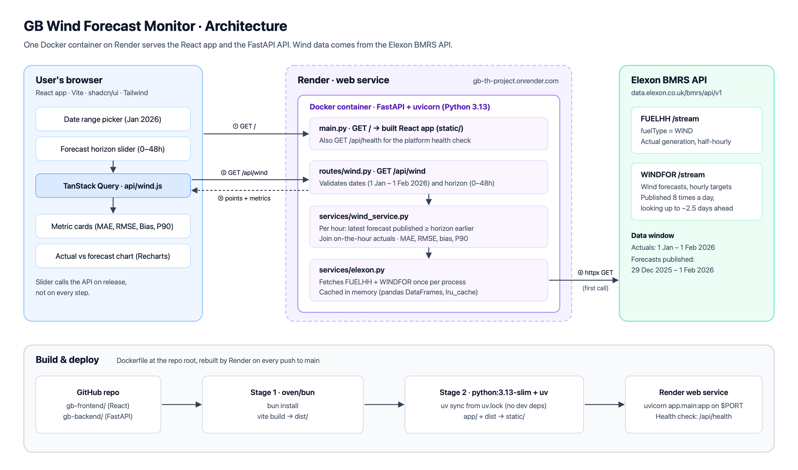

# GB Wind Forecast Monitor

A web app for a UK day-ahead power buying team. It shows national wind generation against the
latest wind forecast that was available when a purchase decision had to be made, and measures how
accurate those forecasts were.

**Live app:** https://gb-th-project.onrender.com

> Hosted on Render's free plan, so the app sleeps when idle. The first visit after a quiet period
> can take 30–60 seconds to wake up, and the first data load a few more seconds.

## Architecture



## What it does

- **Latest forecast at decision time.** Pick a delivery date range and a forecast horizon (0–48h).
  For each hour, the app uses the most recent forecast published at least that many hours before
  the hour. For example, 24h shows what the team could have known a day ahead.
- **Forecast accuracy.** For the same range and horizon it reports, in MW:
  - **MAE**: typical size of a miss
  - **RMSE**: weights large misses more
  - **Bias**: actual − forecast on average; negative means less wind than forecast
  - **P90 absolute error**: 90% of hours missed by less than this
- **Chart** of actual vs forecast per hour, with the forecast's publish time in the tooltip.

### Data

Only Elexon BMRS national wind data is used, as the brief requires:

- Actual generation: [FUELHH](https://bmrs.elexon.co.uk/api-documentation/endpoint/datasets/FUELHH/stream), fuel type `WIND` (half-hourly)
- Forecasts: [WINDFOR](https://bmrs.elexon.co.uk/api-documentation/endpoint/datasets/WINDFOR/stream) (hourly targets, published 8 times a day)

The window covers purchase decisions made in January 2026, i.e. delivery days 1 Jan – 1 Feb 2026.
Forecasts are fetched from 29 Dec 2025 so the first days of the window also have long-horizon
forecasts. Near the 48h horizon some hours have no forecast published early enough, and those hours
are skipped rather than filled in. Each WINDFOR publish also restates past hours; those rows are
dropped because they are not forecasts. Forecasts are hourly, so they are compared with the on-the-hour actuals. All times are
UTC, which is also UK time in January.

## Repository structure

```
.
├── Dockerfile               Builds the frontend, then runs FastAPI serving the page and the API
├── docker-compose.yml       Runs the image locally on port 8000
├── render.yaml              Render service definition (free Docker web service)
├── docs/                    Architecture diagram (SVG source + PNG)
├── gb-backend/              Python API (FastAPI + pandas, managed with uv)
│   ├── app/
│   │   ├── main.py          App setup, /api/health, serves the built frontend when present
│   │   ├── routes/wind.py   GET /api/wind: query params and date-range validation
│   │   └── services/
│   │       ├── elexon.py        Fetches FUELHH and WINDFOR once and caches them in memory
│   │       └── wind_service.py  Picks the forecast per hour, joins actuals, computes metrics
│   ├── tests/               pytest tests for the service logic and the route
│   ├── pyproject.toml
│   └── uv.lock
└── gb-frontend/             React app (Vite, JavaScript, Tailwind, shadcn/ui, TanStack Query)
    ├── src/
    │   ├── App.jsx                     Page: date range, horizon slider, metrics, chart
    │   ├── api/wind.js                 Calls GET /api/wind
    │   ├── components/
    │   │   ├── DateRangePicker.jsx     shadcn calendar limited to the January window
    │   │   ├── MetricCard.jsx
    │   │   ├── WindChart.jsx           Recharts line chart via shadcn chart
    │   │   └── ui/                     Generated shadcn/ui components
    │   └── test/setup.js               Vitest setup
    ├── vite.config.js       Tailwind plugin, @ alias, /api proxy for development, test config
    └── package.json
```

## Running the app

### With Docker

Requires Docker.

```bash
docker compose up --build
```

Open http://localhost:8000.

### Without Docker (development)

Requires [uv](https://docs.astral.sh/uv/) and [Bun](https://bun.sh).

Backend, on http://localhost:8000:

```bash
cd gb-backend
uv sync
uv run fastapi dev app/main.py
```

Frontend, on http://localhost:5173 (proxies `/api` to the backend):

```bash
cd gb-frontend
bun install
bun dev
```

### Tests

```bash
cd gb-backend && uv run pytest
```

```bash
cd gb-frontend && bun run test
```

The tests do not call Elexon.

## API

`GET /api/wind?start=2026-01-01&end=2026-01-07&horizon_h=4`

| Param | Default | Rules |
|---|---|---|
| `start`, `end` | `2026-01-01`, `2026-01-07` | Inclusive delivery days within 2026-01-01 – 2026-02-01, `start <= end` (else 400) |
| `horizon_h` | `4` | 0–48 (else 422) |

Response:

```json
{
  "points": [
    { "time": "2026-01-01T00:00:00+00:00", "published": "2025-12-31T18:30:00+00:00", "actual": 13756, "forecast": 19767 },
    ...
  ],
  "metrics": { "mae": 2043.1, "rmse": 2529.5, "bias": -1347.4, "p90_abs_error": 4147.6 }
}
```

`GET /api/health` returns `{"status": "ok"}`. Interactive docs are at `/docs`.

## Deployment

The app runs as a single Docker container on [Render](https://render.com): the Dockerfile builds the
React app and FastAPI serves it alongside `/api`, so there is one URL and no CORS setup.

The brief suggests Vercel or Heroku. Render was chosen because it runs the same Dockerfile used
locally on a free plan. Vercel does not run Docker images, and Heroku has no free tier.

## Use of AI tools

This project was built with help from AI coding tools (Claude Code by Anthropic), used for
scaffolding, writing and reviewing code and tests, and drafting documentation. All code was reviewed
and run locally and on the live deployment.
